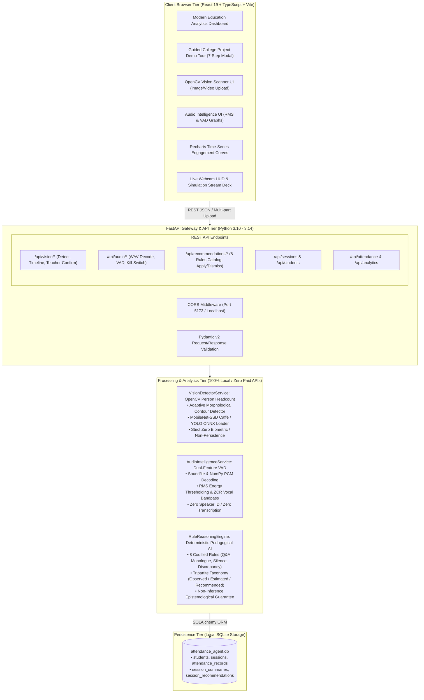

# 🎓 Multimodal Attendance & Engagement Agent

[](https://fastapi.tiangolo.com)
[](https://react.dev/)
[](https://www.typescriptlang.org/)
[](https://vitejs.dev/)
[](https://www.sqlite.org/)
[](#testing)

An intelligent, real-time education analytics platform combining computer vision, acoustic telemetry, and an autonomous pedagogical coaching agent. The system provides local OpenCV classroom image/video person detection and headcount estimation, local audio WAV analysis with voice activity detection and silence interval tracking, teacher-supervised attendance confirmation, and a transparent, deterministic rule-based pedagogical recommendation agent.

---

## 🌟 Key Features

### 1. 📷 Classroom Vision Headcount Module (Python & OpenCV)
- **Classroom Image & Video Processing:** Analyzes uploaded local classroom images (.jpg, .png, .webp, .bmp) and video recordings (.mp4, .avi, .mov) with frame sampling.
- **Pretrained Person Detectors:** Supports MobileNet-SSD (Caffe) and YOLO ONNX person detectors via `backend/models/weights/` with an out-of-the-box adaptive morphological contour detector (zero external download required).
- **Strict Privacy & Zero Biometrics:** Deliberately does **not** perform facial recognition or biometric identification.
- **No Cross-Frame Identity Persistence:** Person counts represent instantaneous spatial presence without assuming detections across frames correspond to unique student identities.
- **Authorized Teacher Attendance Workflow:** Human-in-the-loop workflow where an authorized teacher reviews detected headcounts against the enrolled roster and signs off on attendance records (`vision_assisted_manual_confirm`).
- **Transient Local Storage:** Uploaded media is processed in memory and discarded by default. Optional local retention includes dedicated single-file and bulk deletion endpoints.
- **Interactive Demo Simulation Mode:** Fully functional mode operating without downloading model weights, clearly labeled with `is_simulated: true` and amber visual tags.

### 2. 🎙️ Classroom Audio Intelligence Module (Python, soundfile, NumPy, SciPy)
- **Local WAV Audio Processing:** Decodes local WAV, OGG, and FLAC audio files using `soundfile` and `NumPy` with standard library `wave` fallback.
- **Dual-Feature Voice Activity Detection (VAD):** Adaptive RMS energy thresholding combined with Zero-Crossing Rate (ZCR) vocal tract bandpass filtering ($0.018 \le \text{ZCR} \le 0.58$) and hangover median smoothing.
- **Duration & Silence Interval Tracking:** Pinpoints reflective pause intervals ($\ge 0.40\text{s}$) with precise start and end timestamps.
- **Session-Level Participation Indicators:** Produces time-series charts (Recharts) for RMS energy and speech activity, Vocal Participation Index ($0 - 100\%$), dialogue turnover estimation, and acoustic environment classification (`quiet_attentive_lecture`, `active_discussion`, `collaborative_work`, `elevated_ambient_noise`).
- **Administrative Kill-Switch:** Master system toggle (`POST /api/audio/toggle-processing`) to disable all audio uploads and microphone analysis entirely.
- **Strict Ethical Boundaries:** Zero speaker identification, zero conversational speech transcription, transient volatile processing, and rigorous rejection of the fallacy that loudness equals student engagement.

### 3. 🧠 Transparent Analytics & Recommendation Agent (Deterministic Offline Engine)
- **Zero LLM API Key / Cloud Dependency:** Operates 100% locally and deterministically with codified pedagogical heuristics and multi-signal synthesis.
- **Tripartite Epistemological Taxonomy:** Strictly partitions every output into `OBSERVED_MEASUREMENT` (ground-truth physical/roster counts), `STATISTICAL_ESTIMATE` (acoustic/spatial models), and `PEDAGOGICAL_RECOMMENDATION` (actionable advice).
- **Non-Inference of Cognitive States:** Formally guarantees that attention, emotions, comprehension, and learning outcomes are **never** presented as directly detected facts.
- **8 Codified Reasoning Rules:**
  - `RULE_LOW_PARTICIPATION_QA`: Recommends structured Q&A / Think-Pair-Share when vocal activity < 20% and turn-taking is low.
  - `RULE_PROLONGED_MONOLOGUE_PAUSE`: Suggests a 90-second reflection pause when instructor speech density > 70%.
  - `RULE_EXTENDED_SILENCE_PROBE`: Suggests checking on independent student work during silence intervals >= 40s.
  - `RULE_ATTENDANCE_DROP_REVIEW`: Flags when current attendance drops >= 15% below historical course baseline.
  - `RULE_HEADCOUNT_DISCREPANCY`: Detects discrepancies between peak optical camera headcounts and verified attendance rosters.
  - `RULE_NOISY_COLLABORATION_WRAPUP`: Recommends group synthesis transition during loud, high-turnover peer discourse.
  - `RULE_BALANCED_DISCOURSE_AFFIRMATION`: Affirms interactive balance when speech ratio is 25-60% with frequent dialogue turns.
  - `RULE_MISSING_MODALITY_NOTICE`: Transparently notifies teachers when camera or audio streams are disabled or missing.
- **Teacher In-The-Loop Feedback:** Empowers teachers to mark recommendations as *Applied* with instructional notes or *Dismiss* with deliberate pedagogical rationale.
- **SQLite Persistence:** Stores comprehensive session summaries and timestamped recommendations in SQLite tables `session_summaries` and `session_recommendations`.

### 4. 👁️ Multimodal Student Engagement Telemetry & Fusion Engine
- **Engagement Fusion Formula:** Fuses visual attention (60% weight) and acoustic participation (40% weight) into an index (0–100%).
- **Time-Series Curves:** Generates minute-by-minute classroom pulse charts (Recharts) with attention vs. vocal activity curves.
- **Eye Gaze & Focus Estimation:** Analyzes gaze direction (`center`, `left`, `right`, `down`) and pupil-screen alignment.
- **Drowsiness & Fatigue Detection:** Tracks Eye Aspect Ratio (EAR) fluctuations (< 0.22 threshold) to flag student drowsiness.
- **Student Engagement Leaderboard:** Ranks students by consistency, attendance rate, and attention metrics.

### 5. 💻 Modern Education Analytics UI
- **Design Aesthetic:** Ultra-clean education dashboard with white background, deep blue accents (`#2563eb`), slate typography, and micro-animations.
- **Dual Live Stream:** Live WebRTC webcam & mic stream with real-time HUD bounding box overlay + High-Fidelity Simulation Stream mode (usable without webcam!).
- **Full Management Suite:** Attendance roster with CSV export, session creation & lifecycle control, and student biometric registration modal.

### 6. 🎓 Guided College Project Demonstration Mode & Ethical Boundary Markers
- **7-Step Guided Showcase Tour:** Dedicated modal walkthrough covering 100% offline edge computing, OpenCV contour vision, dual-feature audio VAD, and rule engine.
- **Clear Data Distinction:** Unambiguous visual indicators and JSON metadata (`is_simulated: true` vs `false`) explicitly distinguishing pre-seeded sample data and simulated streams from live camera/microphone analysis.
- **Epistemological Guardrails:** Explicit disclaimers ensuring no psychological or cognitive inner states (attention, comprehension, emotion) are claimed as measured ground-truth facts.

---

## 🏗️ Architecture



```
                                  BROWSER CLIENT (React + Vite + TypeScript)
                     ┌──────────────────────────────────────────────────────────────────┐
                     │  • WebRTC Camera & Mic Feed  /  Simulation Stream Deck           │
                     │  • Real-time Face HUD & Gaze Bounding Box Overlay                │
                     │  • Interactive Recharts Engagement Curves & Attendance Roster    │
                     │  • Guided College Project Demonstration Showcase Modal (7 Steps) │
                     └───────────────────────────────┬──────────────────────────────────┘
                                                     │ HTTP / JSON API (CORS enabled)
                                                     ▼
                                    FASTAPI BACKEND (Python 3.10 - 3.14)
   ┌─────────────────────────────────────────────────┬─────────────────────────────────────────────────┐
   │                  Routers                        │                     Services                    │
   │  • /api/vision (Classroom Person Counting)       │  • VisionDetector: OpenCV Headcount & Timeline  │
   │  • /api/audio (VAD & Acoustic Telemetry)        │  • AudioIntelligence: Soundfile, RMS & Silence  │
   │  • /api/recommendations (Rule Reasoning Engine) │  • RuleReasoningEngine: 8 Codified Heuristics   │
   │  • /api/multimodal/process-frame                │  • AnalyticsModule: Multimodal Fusion Engine    │
   │  • /api/attendance & /api/sessions              │  • RecommendationAgent: Pedagogical AI Coach    │
   └─────────────────────────────────────────────────┴───────────────────────────────┬─────────────────┘
                                                                                     │ SQLAlchemy ORM
                                                                                     ▼
                                                                            SQLITE PERSISTENT DB
                                                                           (attendance_agent.db)
```

---

## 📁 Project Directory Structure

```
.
├── backend/
│   ├── models/                # SQLAlchemy ORM Models
│   │   ├── weights/           # Pretrained DNN weights (MobileNet-SSD, YOLO ONNX)
│   │   ├── student.py         # Student records & biometric face template storage
│   │   ├── session.py         # Classroom sessions (scheduled, live, completed)
│   │   ├── attendance.py      # Attendance verification records
│   │   ├── engagement.py      # Multimodal telemetry logs
│   │   ├── insight.py         # Agent pedagogical recommendations
│   │   └── recommendation.py  # SessionSummary & SessionRecommendation ORM models
│   ├── schemas/               # Pydantic v2 Request/Response validation
│   │   ├── vision.py          # Vision detection & teacher confirmation schemas
│   │   ├── audio.py           # Audio analysis & VAD telemetry schemas
│   │   ├── recommendation.py   # Rule reasoning engine & recommendation schemas
│   │   ├── student.py
│   │   ├── session.py
│   │   ├── attendance.py
│   │   ├── engagement.py
│   │   ├── multimodal.py
│   │   └── insight.py
│   ├── services/              # Core Domain Modules
│   │   ├── rule_reasoning_engine.py # Deterministic multi-signal rule reasoning engine
│   │   ├── audio_intelligence.py # Local WAV audio decoding, VAD, RMS energy & silence
│   │   ├── vision_detector.py # OpenCV classroom person detection & video timeline
│   │   ├── vision.py          # Multimodal gaze & EAR tracking module
│   │   ├── audio.py           # Audio module (VAD, RMS volume, acoustics)
│   │   ├── analytics.py       # Multimodal fusion and time-series aggregation
│   │   └── recommendation_agent.py # Pedagogical AI recommendation engine
│   ├── routers/               # FastAPI API Routes
│   │   ├── recommendations.py # Rule reasoning & teacher workflow endpoints (/api/recommendations/...)
│   │   ├── audio.py           # Audio analysis & kill-switch endpoints (/api/audio/...)
│   │   ├── vision.py          # Classroom vision endpoints (/api/vision/...)
│   │   ├── students.py
│   │   ├── sessions.py
│   │   ├── attendance.py
│   │   ├── multimodal.py
│   │   ├── analytics.py
│   │   └── insights.py
│   ├── tests/                 # Automated test suite (37 tests passing)
│   │   ├── test_api.py        # Core API & ingestion tests (7 tests)
│   │   ├── test_vision.py     # Vision detection & confirmation tests (11 tests)
│   │   ├── test_audio.py      # Audio decoding, VAD & kill-switch tests (8 tests)
│   │   ├── test_recommendations.py # Rule reasoning engine & ethics tests (8 tests)
│   │   └── test_end_to_end_integration.py # Full lifecycle integration tests (3 tests)
│   ├── ANALYTICS_RECOMMENDATION_MODULE.md # Transparent rule engine & epistemological spec
│   ├── VISION_MODULE.md       # In-depth OpenCV architecture & privacy documentation
│   ├── AUDIO_MODULE.md        # Comprehensive Audio & VAD documentation
│   ├── config.py              # Environment configuration loader
│   ├── database.py            # SQLite connection engine & SessionLocal
│   ├── seed_data.py           # Realistic synthetic demo dataset
│   ├── main.py                # FastAPI app initialization, CORS & health checks
│   ├── requirements.txt       # Python dependencies (fastapi, opencv, soundfile, etc.)
│   ├── .env.example           # Environment template
│   └── .env                   # Local development environment settings
├── frontend/
│   ├── src/
│   │   ├── components/
│   │   │   ├── CollegeProjectDemoModal.tsx # Guided 7-step college presentation showcase modal
│   │   │   ├── AudioIntelligenceView.tsx # Audio VAD & RMS energy telemetry UI
│   │   │   ├── VisionScannerView.tsx  # Classroom Vision Scanner & Teacher Review UI
│   │   │   ├── Sidebar.tsx            # Left navigation bar with live status
│   │   │   ├── Header.tsx             # Header with quick ingestion pulse action
│   │   │   ├── DashboardOverviewView.tsx # Summary KPI cards & pulse chart
│   │   │   ├── LiveMonitorView.tsx    # Interactive webcam & synthetic HUD monitor
│   │   │   ├── AttendanceView.tsx     # Attendance table with CSV export
│   │   │   ├── AnalyticsView.tsx      # Engagement deep-dive charts & leaderboard
│   │   │   ├── InsightsView.tsx       # AI teaching agent alerts & intervention feed
│   │   │   ├── StudentsView.tsx       # Student directory & face enrollment modal
│   │   │   └── SessionsView.tsx       # Session management & live stream launcher
│   │   ├── services/
│   │   │   └── api.ts                 # Typed fetch client connecting to FastAPI
│   │   ├── types/
│   │   │   └── index.ts               # TypeScript interfaces (vision & audio models)
│   │   ├── App.tsx                    # Root dashboard application state
│   │   ├── index.css                  # Custom design system tokens & animations
│   │   └── main.tsx                   # React 19 entry point
│   ├── index.html                     # HTML5 template with Google Fonts Inter & Outfit
│   ├── package.json                   # Frontend dependencies (React, Vite, Recharts, Lucide)
│   ├── tsconfig.json
│   └── vite.config.ts
├── package.json               # Root scripts runner
├── requirements.txt           # Root requirements copy
├── .env.example               # Root environment variables guide
└── README.md                  # Comprehensive setup & user manual
```

---

## 🚀 Setup & Launch Guide

### Prerequisites
- **Python:** 3.10+ (Tested on Python 3.14 on Windows)
- **Node.js:** 18+ (Tested on Node v24.11 / npm 11)

---

### Step 1: Backend Setup & Execution (Windows PowerShell)

Open PowerShell and execute:

```powershell
# 1. Navigate to the backend directory
cd "e:\tiwaris project\backend"

# 2. Create the Python virtual environment (if not already created)
python -m venv venv

# 3. Activate the virtual environment
.\venv\Scripts\Activate.ps1

# 4. Upgrade pip and install all backend dependencies
pip install --upgrade pip
pip install -r requirements.txt

# 5. Initialize SQLite database with pristine demo records & rule recommendations
python seed_data.py

# 6. Start the FastAPI development server
uvicorn main:app --reload --host 127.0.0.1 --port 8000
```

> 💡 **Backend Server URL:** `http://127.0.0.1:8000`  
> 📖 **Interactive Swagger UI:** `http://127.0.0.1:8000/docs`  
> 🩺 **System & Modality Health Check:** `http://127.0.0.1:8000/api/health`

---

### Step 2: Frontend Setup & Launch (Windows PowerShell)

Open a second PowerShell window and execute:

```powershell
# 1. Navigate to the frontend directory
cd "e:\tiwaris project\frontend"

# 2. Install Node dependencies (React 19, TypeScript, Lucide, Recharts)
npm install

# 3. Launch the Vite development server
npm run dev

# 4. Open the dashboard in your default browser
Start-Process "http://localhost:5173"
```

> 🌐 **Live Web Application URL:** `http://localhost:5173`

---

## 🧪 Running Automated Tests

Run the backend integration test suite across all 4 module suites (Core API, Vision Detector, Audio Intelligence, and Rule-Based Recommendation Agent):

```bash
cd "e:\tiwaris project\backend"
.\venv\Scripts\python.exe -m pytest -v
```

Expected output:
```
tests/test_api.py::test_health_check PASSED                              [  2%]
tests/test_api.py::test_get_students PASSED                              [  5%]
tests/test_api.py::test_get_sessions PASSED                              [  8%]
tests/test_api.py::test_analytics_overview PASSED                        [ 10%]
tests/test_api.py::test_multimodal_process_frame PASSED                  [ 13%]
tests/test_api.py::test_session_trends PASSED                            [ 16%]
tests/test_api.py::test_insights PASSED                                  [ 18%]
tests/test_audio.py::test_audio_status_and_privacy_declarations PASSED   [ 21%]
tests/test_audio.py::test_toggle_audio_processing_killswitch PASSED      [ 24%]
tests/test_audio.py::test_analyze_wav_demo_mode PASSED                   [ 27%]
tests/test_audio.py::test_analyze_wav_actual_processing PASSED           [ 29%]
tests/test_audio.py::test_analyze_wav_invalid_extension PASSED           [ 32%]
tests/test_audio.py::test_analyze_wav_empty_file PASSED                  [ 35%]
tests/test_audio.py::test_analyze_wav_oversized PASSED                   [ 37%]
tests/test_audio.py::test_retained_audio_and_deletion_workflow PASSED    [ 40%]
tests/test_end_to_end_integration.py::TestEndToEndApplicationFlow::test_e2e_full_lifecycle_flow PASSED [ 43%]
tests/test_end_to_end_integration.py::TestEndToEndApplicationFlow::test_e2e_input_validation_and_error_handling PASSED [ 45%]
tests/test_end_to_end_integration.py::TestEndToEndApplicationFlow::test_e2e_offline_demo_mode_operability PASSED [ 48%]
tests/test_recommendations.py::test_get_reasoning_rules_catalog PASSED   [ 51%]
tests/test_recommendations.py::test_generate_recommendations_low_participation_rule PASSED [ 54%]
tests/test_recommendations.py::test_generate_recommendations_monologue_pause_rule PASSED [ 56%]
tests/test_recommendations.py::test_generate_recommendations_headcount_discrepancy_rule PASSED [ 59%]
tests/test_recommendations.py::test_separation_of_epistemological_categories_and_notice PASSED [ 62%]
tests/test_recommendations.py::test_missing_modality_handling PASSED     [ 64%]
tests/test_recommendations.py::test_recommendation_apply_and_dismiss_workflow PASSED [ 67%]
tests/test_recommendations.py::test_get_session_recommendations_endpoint PASSED [ 70%]
tests/test_vision.py::test_get_vision_model_status PASSED                [ 72%]
tests/test_vision.py::test_detect_image_demo_mode PASSED                 [ 75%]
tests/test_vision.py::test_detect_image_actual_opencv PASSED             [ 78%]
tests/test_vision.py::test_detect_image_invalid_extension PASSED         [ 81%]
tests/test_vision.py::test_detect_image_oversized PASSED                 [ 83%]
tests/test_vision.py::test_detect_video_demo_mode PASSED                 [ 86%]
tests/test_vision.py::test_detect_video_actual_opencv PASSED             [ 89%]
tests/test_vision.py::test_detect_video_invalid_extension PASSED         [ 91%]
tests/test_vision.py::test_retained_media_and_deletion_workflow PASSED   [ 94%]
tests/test_vision.py::test_teacher_confirm_attendance_workflow PASSED    [ 97%]
tests/test_vision.py::test_teacher_confirm_attendance_invalid_session PASSED [100%]
======================= 37 passed in 4.35s =======================
```

To test frontend compilation:
```bash
cd "e:\tiwaris project\frontend"
npm run build
```

---

## 🕹️ Interactive Features Walkthrough

### 0. 🎓 Guided College Project Demonstration Tour (Recommended for Reviewers & Faculty)
1. **Launch the Tour:** Click the **"Project Demo Tour"** button located in the top navigation header, the left sidebar showcase card, or the banner on the Overview tab.
2. **7-Step Guided Showcase Modal:**
   - **Step 1: Project Overview & Offline Architecture:** Explains the 100% offline edge computing stack, zero cloud LLM dependencies, and ethical non-invasive design.
   - **Step 2: Course Session Lifecycle & Demo Cohort:** Explores `CS-401` (Live Deep Learning lecture), `DS-204` (Completed lecture), and `AI-502` (Scheduled lecture) with 8 enrolled students.
   - **Step 3: OpenCV Vision Scanner & Teacher Attendance Sign-Off:** Demonstrates classroom image and video headcount estimation and human-in-the-loop teacher attendance sign-off (`vision_assisted_manual_confirm`).
   - **Step 4: Classroom Audio Intelligence & Dual-Feature VAD:** Demonstrates vocal activity tracking with RMS volume + ZCR spectral filtering and the hardware privacy kill-switch.
   - **Step 5: Multimodal Analytics & Engagement Curves:** Shows the 60% visual / 40% vocal mathematical fusion formula and interactive Recharts time-series curves.
   - **Step 6: Rule-Based AI Recommendation Agent:** Showcases 8 transparent pedagogical rules (Q&A pacing, monologue pauses, attendance drop warnings) with teacher apply/dismiss feedback.
   - **Step 7: Epistemological Integrity Standard:** Explains the scientific separation between observed facts, statistical models, and pedagogical advice.

### 1. Live Classroom Monitor
1. Navigate to **Live Classroom Hub** in the left sidebar.
2. Choose between:
   - **Simulation Mode:** Runs a realistic simulated feed with automated face detection, bounding boxes, gaze vectors, and acoustic spectrum.
   - **Live Webcam & Mic:** Connects your real webcam and microphone; analyzes your live video frame and microphone decibel levels in real time!
3. Enable **Auto-mark Attendance** to watch the system recognize students and record their attendance automatically.
4. Watch the **AI Pedagogical Agent** surface live interventions whenever drowsiness or attention drops occur.

### 2. Attendance Roster
1. Navigate to **Attendance Roster**.
2. Select any session (e.g. `CS-401-2026`).
3. View the student verification badge (`Biometric Face`), facial match confidence percentage, and timestamp.
4. Override any record status (`Present`, `Late`, `Absent`) or click **Export CSV** to download a spreadsheet.

### 3. Engagement & Analytics
1. Navigate to **Engagement Analytics**.
2. Review the minute-by-minute timeline curve comparing Visual Attention % against Vocal Participation %.
3. Inspect facial affect distribution (Focused, Neutral, Confused, Distracted).
4. View the student leaderboard ranked by multimodal engagement score.

### 4. AI Teaching Assistant & Insights
1. Navigate to **AI Teaching Agent**.
2. Review categorized pedagogical cards: *Critical Alerts*, *Teaching Strategies*, *Pacing Interventions*, and *Positive Praise*.
3. Click **Synthesize Pedagogical Recap** to prompt the recommendation agent to formulate fresh lecture insights.
4. Click **Mark Addressed** to resolve active alerts with notes.

### 5. Student Directory & Biometrics
1. Navigate to **Student Directory**.
2. Click **Update Face** on any student.
3. Capture a snapshot via webcam or click **Synthetic Vector** to enroll a 32-dimensional biometric facial embedding directly into SQLite.

---

## 📋 API Endpoints Reference

| Method | Endpoint | Description |
|---|---|---|
| `GET` | `/` | Service root and active modules listing |
| `GET` | `/api/health` | Health check and SQLite connectivity status |
| `GET` | `/api/students` | List all enrolled students |
| `POST` | `/api/students` | Register a new student |
| `POST` | `/api/students/{id}/enroll-face` | Ingest face photo and extract 32-dim biometric vector |
| `GET` | `/api/sessions` | List class sessions with attendance counts and engagement |
| `POST` | `/api/sessions` | Create a new class session |
| `POST` | `/api/sessions/{id}/start` | Activate session to `live` status |
| `POST` | `/api/sessions/{id}/stop` | Conclude session and mark `completed` |
| `GET` | `/api/attendance/{session_id}` | Fetch attendance records with student profile details |
| `POST` | `/api/attendance/mark` | Mark or update individual attendance |
| `POST` | `/api/attendance/batch-verify` | Batch verify attendance for student cohort |
| `POST` | `/api/multimodal/process-frame` | **Core pipeline**: Ingests image & audio, matches face, tracks gaze, detects drowsiness, logs metrics, and triggers agent recommendations |
| `GET` | `/api/analytics/overview` | High-level dashboard summary KPIs |
| `GET` | `/api/analytics/session/{id}/trends`| Minute-by-minute engagement curves for charts |
| `GET` | `/api/insights/{session_id}` | Retrieve AI recommendations and active alerts |
| `POST` | `/api/insights/generate/{session_id}`| Trigger recommendation agent to generate pedagogical recap |
| `POST` | `/api/insights/{id}/resolve` | Acknowledge and resolve an active alert |
| `GET` | `/api/recommendations/rules` | Public catalog of deterministic reasoning rules & thresholds |
| `POST` | `/api/recommendations/generate/{session_id}` | Execute multi-signal rule reasoning engine & persist to SQLite |
| `GET` | `/api/recommendations/session/{session_id}` | Fetch stored session summaries and recommendations |
| `POST` | `/api/recommendations/{id}/apply` | Teacher applies recommendation with instructional notes |
| `POST` | `/api/recommendations/{id}/dismiss` | Teacher dismisses recommendation with deliberate pedagogical rationale |
| `GET` | `/api/audio/status` | Audio intelligence engine status & ethical privacy declarations |
| `POST` | `/api/audio/toggle-processing` | Admin master kill-switch to disable/enable audio analysis |
| `POST` | `/api/audio/analyze-wav` | Upload WAV audio for local energy, VAD, and silence tracking |
| `GET` | `/api/vision/status` | OpenCV person detection status and model weight detection |
| `POST` | `/api/vision/detect-image` | Upload classroom image for person detection & bounding boxes |
| `POST` | `/api/vision/detect-video` | Upload classroom video for temporal timeline person counting |
| `POST` | `/api/vision/confirm-attendance` | Authorized teacher reviews detection and signs off attendance |

---

## 👥 Demo Dataset

The application initializes with realistic, clearly labeled synthetic demo data:
- **8 Students:** Aarav Sharma, Sophia Chen, Marcus Vance, Priya Patel, Liam O'Connor, Elena Rostova, David Kim, Zoe Al-Mansoor.
- **3 Sessions:**
  - `CS-401`: *Deep Learning & Attention Mechanics* (**Live** session in progress).
  - `DS-204`: *Advanced Data Structures & Algorithms* (**Completed** lecture).
  - `AI-502`: *Multimodal Machine Learning Architectures* (**Scheduled** upcoming lecture).
- **Time-Series Telemetry:** 35 minutes of continuous engagement logs, gaze tracking samples, acoustic energy levels, and pedagogical alert histories.
- **Pre-Evaluated Rule Recommendations:** Session summaries and recommendation cards automatically computed for initial sessions.

---

## 🔒 Security & Privacy Guarantees

- **No Facial Recognition or Biometrics in Classroom Scanners:** Vision person counting estimates instantaneous spatial presence only. It deliberately avoids facial identification.
- **No Conversational Transcription:** The Audio module tracks RMS energy and Voice Activity Detection (VAD) bandpass characteristics without transcribing private student speech.
- **Epistemological Integrity:** Internal states (attention, emotion, comprehension) are strictly treated as non-observable internal phenomena, never reported as facts.
- **Secrets Handling:** Secrets and keys are never hardcoded; they are managed through `.env` files using `python-dotenv`.
- **CORS:** Configured for local development (`http://localhost:5173`, `http://127.0.0.1:5173`).
- **SQLite Concurrency:** Handled cleanly with `check_same_thread=False` and connection pooling.

---

## ⚠️ Known Limitations

1. **Acoustic Reverberation & Ambient Echo:** In large halls with hard surfaces, reverberation can cause short delays in silence detection. The engine uses a 400ms hangover window and median filtering to minimize false speech triggers.
2. **Visual Occlusion & Camera Angles:** In lecture auditoriums with stadium seating, students sitting directly behind tall pillars or front-row occupants may be partially occluded in wide camera angles. The system flags optical vs roster discrepancies for teacher review.
3. **Hardware Model Acceleration:** Without GPU CUDA libraries installed, deep neural network person detectors (YOLO / MobileNet-SSD) run in CPU mode (~60-120ms per frame). The built-in adaptive contour detector runs in real time (<15ms per frame) on standard CPUs.

---

---

## 🌐 Production Cloud Deployment Guide (Render & Vercel)

The platform is architected for zero-cost cloud deployment using **Render** for the Python FastAPI backend and **Vercel** for the React Vite frontend.

```
  ┌─────────────────────────────────┐               ┌─────────────────────────────────┐
  │         VERCEL FRONTEND         │               │         RENDER BACKEND          │
  │     (React 19 + TypeScript)     │  HTTPS REST   │     (FastAPI Python 3.11)       │
  │  https://your-agent.vercel.app  ├──────────────►│ https://your-agent.onrender.com │
  │  • Global Edge CDN              │  JSON / Media │  • Uvicorn on dynamic $PORT     │
  │  • Automatic SSL (Camera / Mic) │               │  • Headless OpenCV & Soundfile  │
  └─────────────────────────────────┘               └────────────────┬────────────────┘
                                                                     │
                                                    ┌────────────────┴────────────────┐
                                                    │        DATABASE STORAGE         │
                                                    │  • Free Tier: Ephemeral SQLite  │
                                                    │  • Persistent: Render Postgres  │
                                                    └─────────────────────────────────┘
```

---

### Part 1: Deploy Backend on Render

#### Option A: 1-Click Render Blueprint (Recommended)
1. Push this repository to GitHub.
2. Log in to [Render Dashboard](https://dashboard.render.com).
3. Click **New +** -> **Blueprint**.
4. Connect your GitHub repository.
5. Render detects [`render.yaml`](file:///e:/tiwaris%20project/render.yaml) automatically, configures the web service, creates a secure random `SECRET_KEY`, sets the health check to `/api/health`, and builds the service.

#### Option B: Manual Web Service Setup
1. In Render Dashboard, click **New +** -> **Web Service**.
2. Select your repository and configure:
   - **Name:** `multimodal-attendance-agent-backend`
   - **Language / Runtime:** `Python`
   - **Root Directory:** `backend`
   - **Build Command:** `pip install -r requirements.txt`
   - **Start Command:** `uvicorn main:app --host 0.0.0.0 --port $PORT`
   - **Plan:** `Free`
3. Expand **Advanced** -> **Health Check Path:** set to `/api/health`.
4. Add the following **Environment Variables**:
   | Variable | Value | Purpose |
   |---|---|---|
   | `PYTHON_VERSION` | `3.11.9` | Ensures compatible Python environment |
   | `ENVIRONMENT` | `production` | Enables production mode |
   | `AUTO_SEED_DEMO_DATA` | `true` | Ensures database is pre-seeded on startup |
   | `CORS_ORIGINS` | `*` *(or your Vercel URL)* | Allows cross-origin API access from frontend |
   | `SECRET_KEY` | *(Click Generate)* | Secure application secret key |
   | `DATABASE_URL` | `sqlite:///./attendance_agent.db` | Default local database |
5. Click **Create Web Service**. Wait for the build to finish.
6. Copy your public service URL (e.g. `https://multimodal-attendance-agent-backend.onrender.com`).

---

### Part 2: Deploy Frontend on Vercel

1. Log in to [Vercel Dashboard](https://vercel.com).
2. Click **Add New...** -> **Project** and select your GitHub repository.
3. Configure project settings:
   - **Framework Preset:** `Vite`
   - **Root Directory:** Click **Edit** and choose `frontend`.
   - **Build Command:** `npm run build`
   - **Output Directory:** `dist`
4. Expand **Environment Variables** and add:
   | Key | Value | Notes |
   |---|---|---|
   | `VITE_API_URL` | `https://your-backend.onrender.com` | Your Render public backend URL (no trailing slash) |
5. Click **Deploy**. Vercel will build and deploy your application to `https://your-app.vercel.app`.
6. SPA routing is automatically handled by [`frontend/vercel.json`](file:///e:/tiwaris%20project/frontend/vercel.json) via URL rewrite to `/index.html`.

---

### 💾 Data Persistence & Ephemeral Storage Limitations

> [!IMPORTANT]
> **Understanding Cloud Ephemeral Filesystems:**
> - On Render's **Free Tier**, container filesystems are **ephemeral**. When the backend service sleeps after 15 minutes of inactivity, restarts, or is redeployed with new code, local files (including SQLite `attendance_agent.db` and temporary media in `uploads/temp/`) are reset.
> - **Zero-Downtime Resilience:** The application is built for this! `AUTO_SEED_DEMO_DATA=true` ensures that whenever the free instance wakes up, the schema is auto-migrated and populated with the 8 students, 3 class sessions, and 14 pre-evaluated rule recommendations, so reviewers never encounter a broken or blank dashboard.
> - **Permanent Production Persistence:** To preserve new sessions across redeployments:
>   - **Option 1 (Render Persistent Disk):** Attach a persistent disk to the Render service mounted at `/var/data` and configure `DATABASE_URL=sqlite:////var/data/attendance_agent.db`.
>   - **Option 2 (PostgreSQL):** Create a free PostgreSQL database on Render, Supabase, or Neon. Paste the database connection string into `DATABASE_URL`. The backend automatically converts `postgres://` to `postgresql://` and connects via `psycopg2-binary`.

---

### 🧠 Model Weights in Cloud Deployment

- **Are weight files required?** **No.**
- The platform is designed with zero mandatory binary weights:
  - If no weights exist in `backend/models/weights/`, the backend runs its **OpenCV Adaptive Morphological Contour Detector** (<15ms/frame) and **Dual-Feature ZCR/RMS VAD**.
  - All 8 rule-based AI recommendations, engagement fusion curves, and session attendance workflows work 100% offline without downloading external gigabyte weights.
  - This keeps your cloud repository small (<20MB) and prevents Git LFS bandwidth quotas from being exceeded.

---

## 🔧 Remaining Setup Steps & Optional Upgrades

1. **Pretrained MobileNet-SSD Weights (Optional):**
   - The platform works out-of-the-box using the built-in OpenCV adaptive contour detector and Demo Mode without downloading any weights.
   - To use pretrained MobileNet-SSD Caffe weights, download:
     - `MobileNetSSD_deploy.prototxt`
     - `MobileNetSSD_deploy.caffemodel`
   - Place them inside `backend/models/weights/`. The system will automatically detect them on startup and switch detector mode from `opencv_contour_detector` to `mobilenet_ssd_caffe`.
2. **Microphone & Webcam Permissions:**
   - In browser settings for `http://localhost:5173`, grant camera and microphone access to enable live webcam stream analysis in the **Workspace** tab.

---

## 📄 License
This project is licensed under the MIT License.
